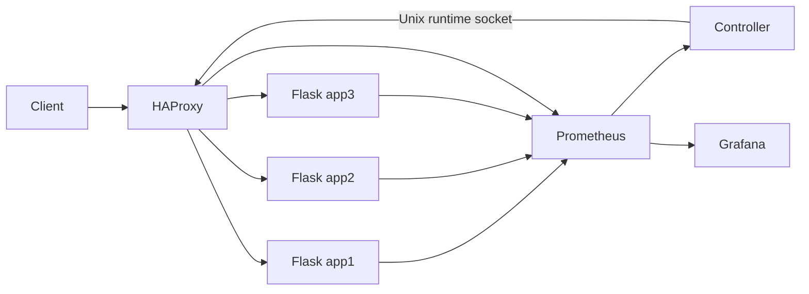

# Cloud-Based Intelligent Load Balancing and Resource Monitoring

This college prototype asks whether a 10-second demand forecast improves routing over a reactive resource-aware controller under the **same** backend pool and workload. It does not assume that prediction wins. Three Flask replicas sit behind HAProxy; Prometheus scrapes application and proxy metrics; a separate Python controller changes HAProxy weights through a shared Unix socket; Grafana shows live signals. The load generator and analyzer save reproducible CSV and plots.



## Prerequisites and start

Python 3.11+ and Docker Desktop with a running Linux engine. From `D:\cloud-project` in PowerShell:

```powershell
python -m pip install -r requirements.txt
docker compose up --build -d
```

Stop with `docker compose down`. The default policy is `reactive`. To switch, set `POLICY` to one of `round_robin`, `static_weighted`, `least_connections`, `reactive`, or `predictive`, then recreate proxy and controller:

```powershell
$env:POLICY='predictive'
docker compose up -d --force-recreate haproxy controller
```

`round_robin`, `static_weighted`, and `least_connections` are native HAProxy modes. Static weights 50:100:150 follow configured CPU allocations 0.5:1:1.5 cores; they are capacity assumptions, not measured performance claims. Reactive and predictive use HAProxy round robin with controller-managed weights. HAProxy health checks exclude down servers regardless of controller state. The proxy keeps its last weights if the controller stops.

## URLs and checks

| Service | URL | Purpose |
|---|---|---|
| Application via HAProxy | http://localhost:8080/ | Replica ID in JSON and `X-Replica-Id` header |
| Controller | http://localhost:8081/status | Active policy, mode, weights, forecast |
| HAProxy metrics | http://localhost:8404/metrics | Proxy metrics, bound to local host |
| Prometheus | http://localhost:9090/targets | Scrape status, bound to local host |
| Grafana | http://localhost:3000/ | Provisioned dashboard, local host |

Grafana development credentials default to `admin` / `admin`; change them through `.env` before sharing the machine. The HAProxy administration socket is on an internal Docker volume and is not published as a network port.

Smoke test with a running Docker engine:

```powershell
Invoke-RestMethod http://localhost:8080/health
Invoke-RestMethod http://localhost:8081/status
Invoke-WebRequest http://localhost:8404/metrics
python -m benchmark.load_generator --duration 10 --rate 10 --output results/smoke.csv
python -m benchmark.analyze_results results/smoke.csv --duration 10 --output results/smoke_analysis
```

Without Docker, verify the backend and analysis pipeline with `python -m benchmark.smoke_local`. It starts one local Flask process and writes `results/local_smoke.csv`, its JSON configuration, summary CSVs, and PNG charts. This does **not** exercise HAProxy or monitoring containers.

## Experiments

One quick comparison, using identical seeded arrivals and backend limits for each policy:

```powershell
python -m benchmark.run_experiments --duration 15 --warmup 15 --rate 10 --pattern step --mix mixed --repetitions 1
```

For a final evaluation use `--repetitions 5` or more and consider `constant`, `step`, `periodic`, and `burst` patterns and `cpu` or `mixed` request mixes. Each run records scheduled arrival, actual send, completion, status, latency, replica, and failure. The open-loop generator schedules independently of completion and marks `generator_overload` when its pending cap is reached. Keep that cap and generator CPU in view. Run summaries report offered rate separately from completed throughput and include error and timeout rates, p50/p95/p99 client latency, SLO violations, and replica distribution. Percentiles with fewer than 20 successes are marked unreliable. The configurable SLO defaults to 0.5 seconds; choose it before comparing policies. Outputs are in `results/experiment/`, with `summary.csv`, `policy_comparison.csv`, and latency, throughput, error, and distribution PNGs. The analysis command accepts raw CSVs to regenerate outputs.

## Controller and forecast

Every two seconds, the controller queries fresh Prometheus samples (15-second maximum age: three 5-second scrapes). CPU is process CPU seconds per second divided by allocated cores; memory is process RSS divided by the 256 MiB container limit; in-flight concurrency is a proxy for work pressure, **not** queue length; latency is mean backend response duration divided by the 0.5-second SLO. Values are clipped to [0,1]. Missing individual signals are excluded and remaining coefficients renormalized (CPU .30, memory .15, concurrency .25, latency .30). Lower pressure receives higher preference, multiplied by configured capacity. Weight movement targets at most five percentage points per cycle, although normalization and unhealthy-backend removal can cause larger effective changes.

Prediction uses up to 60 seconds of recent request rates, persistence or EWMA (`FORECAST=ewma` by default), and a 10-second target horizon. The controller uses available recent rates and falls back to reactive routing until enough valid observations exist or walk-forward MAE is too high. Walk-forward validation avoids future leakage. `FORECAST=persistence` selects the baseline. If cluster telemetry fails, the controller attempts static capacity weights; if a runtime socket update fails it preserves the last valid weights. CPU and memory are process measurements, not host totals or cgroup working set. The Grafana CPU chart divides process CPU use by configured CPU allocations. Platform-specific container accounting may differ.

## Testing and failure demonstration

```powershell
python -m pytest -q
docker compose config --quiet
docker compose stop app2
Invoke-RestMethod http://localhost:8081/status
docker compose start app2
docker compose stop prometheus
Invoke-RestMethod http://localhost:8081/status
docker compose start prometheus
```

Observe `/targets`, `/status`, and client failures while injecting faults. Record detection and recovery times from timestamps; no fixed recovery time is claimed. For controller restart use `docker compose restart controller`. Inspect `docker compose logs controller haproxy` for weight updates and failures.

## Configuration, limits, and troubleshooting

See `.env.example` for `POLICY`, `FORECAST`, interval, SLO, and development credentials. Copy it to `.env` to customize. `POLICY` changes require recreating HAProxy and controller because HAProxy's native balancing algorithm is selected at startup. The predictor currently uses sampled request rates and EWMA or persistence; no regression model is included. The experiment runner writes `forecast_validation.csv` when the predictive controller has enough observations; these are walk-forward validation metrics, not held-out final test results. The analysis reports client results; CPU and memory are collected separately with `benchmark.collect_resources` from Prometheus process metrics. This is not host or cgroup working-set accounting. The prototype uses the Flask development server and root-owned HAProxy control socket on an internal volume; use production-grade serving and tighter container permissions before deploying beyond a local lab.

If `docker compose` cannot connect, start Docker Desktop's Linux engine. If the controller reports telemetry failure, inspect Prometheus `/targets` and allow two scrape intervals after startup. If weight updates fail, check that the proxy and controller share `haproxy_socket`. If a workload fails, inspect `docker compose logs` and use bounded query parameters: CPU `iterations=0..1000000`, I/O `ms=0..1000`.

## Verified Docker evaluation (1 November 2026)

`docker compose up --build -d` started all seven services after fixing permissions on the shared HAProxy socket. The HAProxy container runs as root in this local prototype so it can bind that socket on the Docker volume; the socket remains unpublished. All three backend health checks passed. The proxy served CPU and I/O requests, Prometheus had four healthy targets, process CPU and RSS and application metrics returned samples, and the Grafana dashboard API returned eight panels. The controller's runtime weights matched HAProxy's actual server weights. `python -m pytest -q` passed 7 tests; `python -m benchmark.verify_stack` passed.

`python -m benchmark.verify_policies` observed 20/20/20 requests for native round robin and 10/20/30 for static weights 50/100/150. HAProxy reported `leastconn` for least connections and `roundrobin` with updated weights for reactive and predictive. A 25-second live predictive warm-up produced `mode: predictive`, with validation MAE 2.69 and RMSE 2.96 requests/s at that point. Prediction can revert to reactive when its reliability gate rejects a forecast. `python -m benchmark.verify_runtime_effect` forced weights through the same Runtime API path and shifted 58 of 60 requests to app1; after controller restart, requests again reached all replicas.

Two **short exploratory comparisons** were completed with the same mixed CPU/I/O workload, 25-second warm-up, 12-second measurement, 12 offered requests/s before the step, and three repetitions per policy. Mean p95 client latency (seconds) was:

| Policy | Constant | Step increase |
|---|---:|---:|
| Round robin | 0.068538 | 0.067658 |
| Static weighted | 0.068028 | 0.067509 |
| Least connections | 0.067517 | 0.067664 |
| Reactive | 0.067409 | 0.067769 |
| Predictive | 0.067516 | 0.068146 |

Mean completed throughput was 12.389 requests/s for constant demand and 19.722 requests/s for step demand for every policy, matching offered traffic in these runs. All 30 measured runs had zero client errors and timeouts. The small p95 differences under low CPU pressure do **not** show a predictive advantage; the step condition's predictive mean p95 was slightly higher than reactive. These short runs are insufficient for a statistically strong conclusion. Per-run p50/p95/p99, error/timeout rate, SLO violations, and replica counts are in `results/constant_3x/summary.csv` and `results/step_3x/summary.csv`; raw logs, seeds, configurations, graphs, forecast validation, and observed CPU/memory fractions are alongside them. `forecast_validation.csv` is walk-forward validation, not a held-out test score. Recreate resource summaries with `python -m benchmark.collect_resources results/constant_3x --duration 12` and the corresponding step directory.

Fault tests recorded in `results/fault_verification.json`: app2 exclusion was observed after 7.24 seconds, and requests continued through app1/app3; backend recovery was observed after 2.05 seconds. Prometheus loss triggered static weights 50/100/150 after 7.16 seconds, with telemetry recovery after 4.6 seconds. Requests continued while the controller was stopped, and its recovery was observed after 2.09 seconds. These are observations from one local fault run, not guaranteed recovery times. The stack is left running in predictive mode after verification.

Reproduce the integration checks with `python -m benchmark.verify_stack`, `python -m benchmark.verify_policies`, `python -m benchmark.verify_runtime_effect`, and `python -m benchmark.verify_faults`. The latter two temporarily stop and restart services. The experiment runner command above accepts `--output results/constant_3x` or `--output results/step_3x`; use `--warmup 25 --duration 12 --repetitions 3` to match this evaluation. Use a higher offered load and longer runs for a stronger capacity comparison.

## Team contributions

Replace these placeholders with actual contributions before submission: Member 1 — backend and metrics; Member 2 — HAProxy and controller; Member 3 — experiments and analysis; Member 4 — monitoring and documentation.
